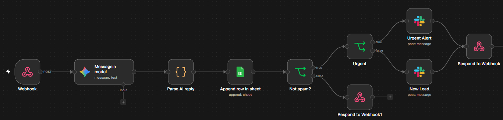
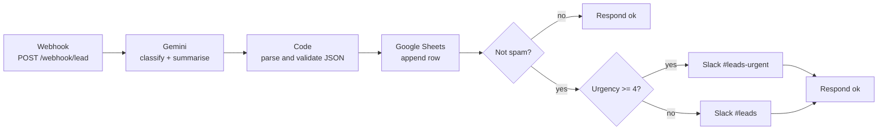
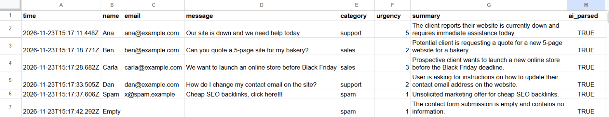
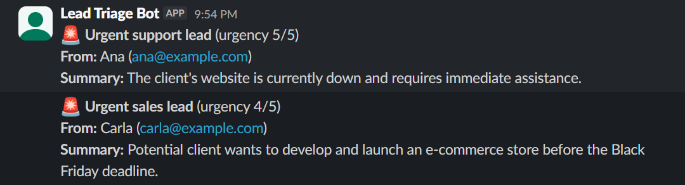
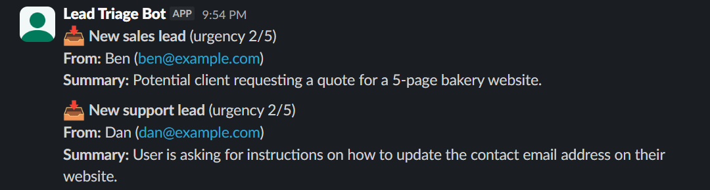

# AI Lead Triage (n8n + Gemini + Google Sheets + Slack)

An n8n workflow that reads every contact-form submission with an LLM, decides whether it is **sales**, **support** or **spam**, scores how urgent it is (1–5), writes a one-sentence summary, logs it to Google Sheets and alerts the right Slack channel.

▶️ **[Watch the 3-minute demo on Loom](https://www.loom.com/share/bd67d6c1f8cd4634bd9a0bc2b689a054)**: a live form submission routed to Slack and logged in the Sheet, plus what happens when the AI is down.



## The problem

A small web agency gets every enquiry in one inbox. Somebody has to read each message, work out what it is, notice the "our site is down" emails quickly and ignore the spam. This workflow does that first pass automatically, in a few seconds per lead:

- **Urgent leads** (site down, hard deadlines) are posted to `#leads-urgent` straight away.
- **Normal leads** are posted to `#leads`.
- **Spam** is logged but never alerts anyone.
- **Every lead** is recorded in a Google Sheet with the AI's category, urgency and summary.

## How it works



| Step | Node | What it does |
|---|---|---|
| 1 | **Webhook** | Receives `{ name, email, message }` as JSON. Responds only after the workflow finishes. |
| 2 | **Message a model** (Google Gemini) | System prompt asks for JSON only: `{"category", "urgency", "summary"}`. |
| 3 | **Parse AI reply** (Code) | Extracts the JSON even if the model wraps it in Markdown or extra words, and replaces any invalid value with a safe default. See [`code-node.js`](code-node.js). |
| 4 | **Append row in sheet** | Logs every lead, spam included, before any branching. |
| 5 | **Not spam?** (IF) | Spam goes straight to a response with no alert. |
| 6 | **Urgent** (IF) | Urgency 4–5 goes to `#leads-urgent`, 1–3 goes to `#leads`. |
| 7 | **Slack** ×2 | Bot posts a formatted message (category, urgency, sender, summary). |
| 8 | **Respond to Webhook** ×2 | Every path ends with `{"ok": true}`, so the form never hangs. |

## Results

Six sample leads from [`test-leads.ps1`](test-leads.ps1), sent to the production webhook:

| Lead | Message | AI category | Urgency | Routed to |
|---|---|---|---|---|
| Ana | Our site is down and we need help today | support | 5 | #leads-urgent |
| Ben | Can you quote a 5-page site for my bakery? | sales | 2 | #leads |
| Carla | We want to launch an online store before Black Friday | sales | 3–4 | #leads or #leads-urgent |
| Dan | How do I change my contact email on the site? | support | 2 | #leads |
| Spam | Cheap SEO backlinks, click here!!! | spam | 1 | no alert |
| Empty | *(blank form)* | spam | 1 | no alert |

**Google Sheets log**



**Slack: `#leads-urgent`**



**Slack: `#leads`**



**Speed:** the six leads above took between 5.0 s and 15.4 s each, end to end, about 7.6 s on average (from n8n's Executions log). Most of that time is the Gemini call. Nobody has to be present while it runs.

Carla's lead scored 3 on one run and 4 on another. LLM scoring isn't fully deterministic for borderline cases, so the prompt (not the IF node) is where to tighten it, for example by defining *"4 = a hard deadline within weeks"*.

## Design decisions

- **Validate everything the AI returns.** The Code node never trusts the model. An unknown category becomes `support` and an out-of-range urgency becomes `3`, so a bad AI reply can't break routing. `ai_parsed` in the Sheet shows when the defaults were used.
- **Form fields come from the Webhook, not the AI.** Name, email and message are read with `$('Webhook').item.json.body`, so the model can't alter or drop them.
- **Log first, then branch.** The Sheets node runs before the IF nodes, so spam is still recorded for auditing.
- **Named node references in the IF and Slack nodes** (`$('Parse AI reply').item.json...`) instead of `$json`. Moving or inserting nodes doesn't change which data they read.
- **Slack bot token with one scope (`chat:write`).** This uses least privilege. Slack's OAuth flow needs an HTTPS redirect, which a localhost n8n doesn't have, so a bot token is the simpler secure choice for a self-hosted demo.
- **Every branch ends at a Respond node.** The caller always gets a reply, including for spam.
- **No lead is lost when the AI is down.** While testing, Google's API returned 503 *"model is experiencing high demand"* errors. The Gemini node now has two layers of protection:
  1. **Retry On Fail:** 3 tries, 5 s apart, which covers short blips.
  2. **On Error → Continue:** if every retry fails, the run carries on. The Code node finds no AI reply and applies its safe defaults (`support`, urgency `3`, summary = the original message, `ai_parsed: FALSE`). The lead is still logged, posted to `#leads` for a person to read, and the form still gets `{"ok": true}`. This was verified during a real Gemini outage.
  3. **Smallest model that does the job:** the workflow uses **Gemini 3.5 Flash-Lite**. It classifies these leads correctly and kept answering while the larger Flash model was returning "high demand" errors.

## Time saved

| Method | Time per lead | Person needed? |
|---|---|---|
| By hand: read, classify, summarise, add a Sheet row, post in Slack | **104 s** (1.7 min) | yes, for all of it |
| This workflow | **~7.6 s** | no, only to read the alert |

**How it was measured:**
- **Manual:** [`time-manual-triage.ps1`](time-manual-triage.ps1) times a person doing every step for the same six sample leads (626 s in total).
- **Automated:** the six production runs in n8n's Executions log.

The manual figure is conservative. The person timed had already seen these leads several times, so someone seeing a new lead would be slower.

**Example:** at 50 leads a week, that's about 87 minutes of hands-on work a week (50 × 104 s) handed to the workflow. Every lead is timestamped in the Sheet, so the real weekly volume can replace the 50 once a live form is connected.

## Run it yourself

**Requirements:** n8n (self-hosted or cloud), a Google Gemini API key, a Google Cloud OAuth client with the Sheets and Drive APIs enabled, and a Slack workspace.

1. **Import** `workflow.json` into n8n (⋯ menu → Import from File).
2. **Gemini:** create a *Google Gemini (PaLM) API* credential with your key and select it in *Message a model*.
3. **Google Sheet:** create a sheet whose row 1 has these headers:
   `time | name | email | message | category | urgency | summary | ai_parsed`.
   Then create a *Google Sheets OAuth2* credential and pick your sheet in *Append row in sheet* (Mapping: **Map Automatically**).
4. **Slack:**
   - Create a Slack app with the bot scope `chat:write` and install it to your workspace.
   - Create channels `#leads` and `#leads-urgent`, and add the app to both (channel → *Integrations* / *Agents & apps*).
   - In n8n, create a *Slack API* credential with the bot token (`xoxb-…`) and select it in both Slack nodes.
5. **Publish** the workflow, then send the sample leads:

   ```powershell
   powershell -ExecutionPolicy Bypass -File .\test-leads.ps1 -All -Prod
   ```

   Every lead should reply `{"ok":true}`. Without `-Prod`, the script uses the test URL. In that case, click **Execute workflow** in n8n first (the script waits up to 2 minutes for it).

Or call the webhook from any form:

```bash
curl -X POST http://localhost:5678/webhook/lead \
  -H "Content-Type: application/json" \
  -d '{"name":"Ana","email":"ana@example.com","message":"Our site is down"}'
```

## Files

| File | Purpose |
|---|---|
| `workflow.json` | The n8n workflow export. It contains no API keys or tokens, only credential names. |
| `code-node.js` | The *Parse AI reply* Code node, with comments. |
| `test-leads.ps1` | Sends the six sample leads to the test or production webhook. |
| `demo/contact-form.html` | A sample website contact form that posts to the webhook. Open it in a browser while n8n runs; add `#demo` to the URL to pre-fill a lead. |
| `time-manual-triage.ps1` | Stopwatch for timing the same triage done by hand (the manual baseline). |
| `screenshots/` | Images used in this README. |

## Possible next steps

- An **Error Trigger** workflow that posts to Slack when any run fails (expired Google token, Gemini quota).
- When `ai_parsed` is false, add "⚠️ AI unavailable, please check urgency" to the Slack message, so a human re-checks leads that were routed with default values.
- **Deduplication** of repeated submissions from the same email within a short window.
- A reply-drafting step for sales leads, and a time-saved counter in the Sheet.
